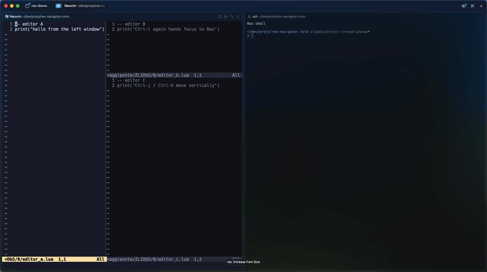

# rex-navigator.nvim

Move between **Neovim windows and [Rex](https://www.superlogical.com/rex) panes**
with the same **Ctrl-h/j/k/l** keys. Neovim windows take precedence; at an editor
edge, focus moves to Rex. From a shell or another program, the keys move directly
between Rex panes.

Inspired by [vim-tmux-navigator](https://github.com/christoomey/vim-tmux-navigator),
with a Neovim plugin and a companion Lua module for Rex.

> **Early-stage:** tested locally with Rex Beta build 1203. Rex APIs may change.

## How it works

```text
                      One Rex tab
+---------------------------------------+-------------+
|                Neovim                 |    shell    |
| +-----------+-----------+-----------+ |             |
| | file tree | editor A  | editor B  | |             |
| +-----------+-----------+-----------+ |             |
+---------------------------------------+-------------+
```



- **Ctrl-l:** file tree → editor A → editor B → Rex shell.
- **Ctrl-h:** back through the same layout, in reverse.

Rex decides whether to forward each navigation key to Neovim. Neovim tries
`wincmd h/j/k/l` first and calls the Rex CLI only when there is no editor window
in that direction. No special integration with Neo-tree or other split-based
file explorers is required.

**Both halves are required.** Installing only the Neovim plugin cannot stop Rex
from intercepting the keys.

## Requirements

- Neovim **0.10+** (`vim.system`).
- Rex with Lua custom actions, `pane.send_key`, `pane.focus`, terminal process
  inspection, `rex.exec`, and `rex do` with session view/focus APIs. Initially
  checked against **Beta 1203**.
- The Rex CLI, found through `REX_BIN_DIR`, `PATH`, or an explicit `rex_cmd`.
- macOS `ps` or a compatible Linux `ps` (such as procps), available on the Rex
  server's PATH for wrapper detection. BusyBox variants may lack the required
  flags. Linux support has not yet been verified end to end.
- Both halves installed on the machine running Neovim and the Rex server.

No Neovim plugin dependencies. Rex Remote Control is **not** needed for keyboard use.

## Install

### 1. Install the Neovim plugin

With [lazy.nvim](https://github.com/folke/lazy.nvim):

```lua
{
  'baggiponte/rex-navigator.nvim',
  main = 'rex-navigator',
  lazy = false,
  opts = {},
}
```

Open Neovim once and let lazy.nvim finish installing before configuring Rex.

With another plugin manager, add this repository to Neovim's runtime path, then:

```lua
require('rex-navigator').setup()
```

Default Ctrl mappings activate only when `REX_SESSION` is set to a nonempty
value. They do not replace bindings outside Rex. Commands and Plug mappings
are defined when the plugin loads, even without `setup()`; outside Rex they
only navigate Neovim windows.

If you also use vim-tmux-navigator, enable it only inside tmux so it does not
install competing mappings in Rex or other terminals:

```lua
{
  'christoomey/vim-tmux-navigator',
  enabled = vim.env.TMUX ~= nil and vim.env.TMUX ~= '',
}
```

Each plugin checks its own environment: Rex uses `REX_SESSION`; tmux-navigator
uses `TMUX`. Nested multiplexers are unsupported. Other plugins mapping the
same keys can still override these mappings; the last mapping installed wins.

### 2. Load the Rex companion

Add this to `~/.config/rex/init.lua`, **after** any existing Ctrl-h/j/k/l bindings:

```lua
local data = os.getenv('XDG_DATA_HOME') or (os.getenv('HOME') .. '/.local/share')
local plugin = data .. '/nvim/lazy/rex-navigator.nvim'
local ok, err = pcall(function()
  dofile(plugin .. '/rex/navigator.lua').setup()
end)
if not ok then
  rex.log('warn', 'rex-navigator not loaded: ' .. tostring(err))
end
```

That is lazy.nvim's default installation path. **The Rex app may not inherit
`XDG_DATA_HOME` from your shell.** If you set it in a shell profile or use
`NVIM_APPNAME`, obtain the default lazy.nvim path inside Neovim:

```vim
:lua print(vim.fn.stdpath('data') .. '/lazy/rex-navigator.nvim')
```

Set `plugin` to that printed absolute path. For a custom lazy.nvim root or a
local checkout, use its actual plugin directory instead. Rex configuration
cannot use Neovim's `vim.fn.stdpath`. The protected load keeps a missing plugin
from aborting the rest of your Rex configuration; inspect the warning if it
fails.

Then run:

```sh
rex config check
rex config reload
```

Restart Neovim if it was already running before the plugin was installed.
App-level Rex shortcut overrides take precedence over `init.lua`.

### 3. Check the setup

From Neovim inside a Rex pane:

```vim
:checkhealth rex-navigator
```

It checks the Neovim version, that `setup()` ran, the Rex session variables,
the Rex CLI, and who owns Ctrl-h/j/k/l. The Rex companion cannot be inspected
from Neovim; `rex config check` covers that half.

## Configuration

Call setup once during startup. Defaults:

```lua
require('rex-navigator').setup({
  mappings = true, -- install Ctrl-h/j/k/l in normal mode
  terminal = true, -- also install terminal-mode navigation
  wrap = true,     -- wrap around Rex panes at the outer layout edge
  -- rex_cmd = '/absolute/path/to/rex', -- override automatic CLI discovery
})
```

To disable Rex-side wrapping as well, pass the option to the companion:

```lua
dofile(plugin .. '/rex/navigator.lua').setup({ wrap = false })
```

The settings are separate: Neovim's option controls handoffs from an editor edge;
the companion's option controls navigation starting in other Rex programs.

For custom Neovim keys, set `mappings = false` and map commands or Plug mappings:

```lua
vim.keymap.set('n', '<M-h>', '<Plug>(RexNavigateLeft)')
```

The companion still binds Ctrl-h/j/k/l by default. Its action names are
`rex_navigate_left`, `rex_navigate_down`, `rex_navigate_up`, and
`rex_navigate_right`.

### Commands and Lua

| Command / Plug mapping | Lua equivalent |
| --- | --- |
| `:RexNavigateLeft` / `<Plug>(RexNavigateLeft)` | `require('rex-navigator').navigate('h')` |
| `:RexNavigateDown` / `<Plug>(RexNavigateDown)` | `require('rex-navigator').navigate('j')` |
| `:RexNavigateUp` / `<Plug>(RexNavigateUp)` | `require('rex-navigator').navigate('k')` |
| `:RexNavigateRight` / `<Plug>(RexNavigateRight)` | `require('rex-navigator').navigate('l')` |

`navigate` returns whether navigation was handled. A successful Rex call returns
true even if Rex has no neighboring pane or a queued key was dropped because
its source pane lost focus. Failed CLI calls produce a warning. The CLI runs
synchronously only at editor edges, with a bounded timeout, and will not start
a Rex server if none is running.

## Limitations

- **Normal and terminal modes only.** Insert-mode keys are untouched. Terminal
  navigation leaves terminal-input mode; fzf keeps its own Ctrl-j/k.
- **Detection is process-based.** The companion forwards keys when Rex's
  foreground process (or its process group, checked with `ps`) is Neovim, so
  shell launchers work without `exec`. The `ps` fallback adds a few tens of
  milliseconds per key in plain shells. A Neovim without this plugin (for
  example `nvim --clean`) still receives the keys but cannot hand focus back.
- **Unsupported:** nested multiplexers (tmux inside or around Rex),
  SSH-hosted Neovim, plain Vim, and vim-tmux-navigator extras such as
  previous-pane toggling, auto-save, and zoom preservation.

## Troubleshooting

Start with `:checkhealth rex-navigator` inside a Rex pane.

**Keys skip Neovim windows and go straight to Rex panes**

1. Run `:RexNavigateRight` inside a Neovim layout that has a window to the right.
   If that works, the Neovim half is working; check the companion's load order
   and any app-level Rex shortcut overrides.
2. Check `:verbose nmap <C-l>` for another plugin or a buffer-local mapping that
   owns the key. The expected global target is `<Plug>(RexNavigateRight)`.
3. Run `rex config check` and `rex config reload` after changing the companion.
   If you use a launcher, make sure the Rex server can run `ps`.

**The CLI is not on PATH**

The plugin first honors `rex_cmd`, then uses `$REX_BIN_DIR/rex`, then tries `rex`
on PATH. Set an absolute `rex_cmd` if your Neovim environment does not inherit
Rex's variables. This changes executable discovery, not server connectivity.

## Development

Run Neovim behavior tests without plugins, a running Rex server, or network access:

```sh
nvim --headless -u NONE -l tests/run.lua
stylua --check lua plugin rex tests
```

The tests exercise real Neovim window navigation with a substituted CLI runner,
execute the scoped handoff script against a fake Rex API, and check companion
routing with stubbed process snapshots and focus state. No live Rex session is
modified. Also run `rex config check` after loading the companion from your Rex
configuration.

To work on a local checkout with lazy.nvim, replace the GitHub spec with
`dir = '/path/to/rex-navigator.nvim'` and point the Rex `dofile` at the same
checkout's `rex/navigator.lua`.

## Acknowledgements

[vim-tmux-navigator](https://github.com/christoomey/vim-tmux-navigator), by
[Chris Toomey](https://github.com/christoomey) and its contributors, established
the editor-first, multiplexer-at-the-edge navigation behavior that inspired
this project. This is an independent Rex integration, not an official port or
a claim of complete feature parity.

## License

[MIT](LICENSE).
